# MistHustlers Software Workflow

This file explains how the MistHustlers app works visually: who uses what, where data goes, and how the frontend, backend, admin dashboard, database, and bin files connect.

## 1. Main Actors

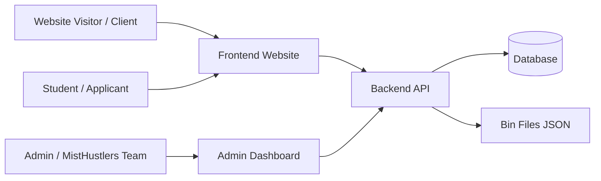

## 2. System Structure

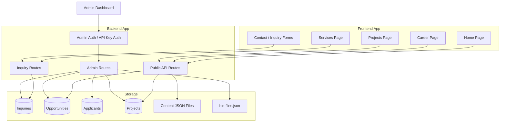

## 3. User Website Workflow

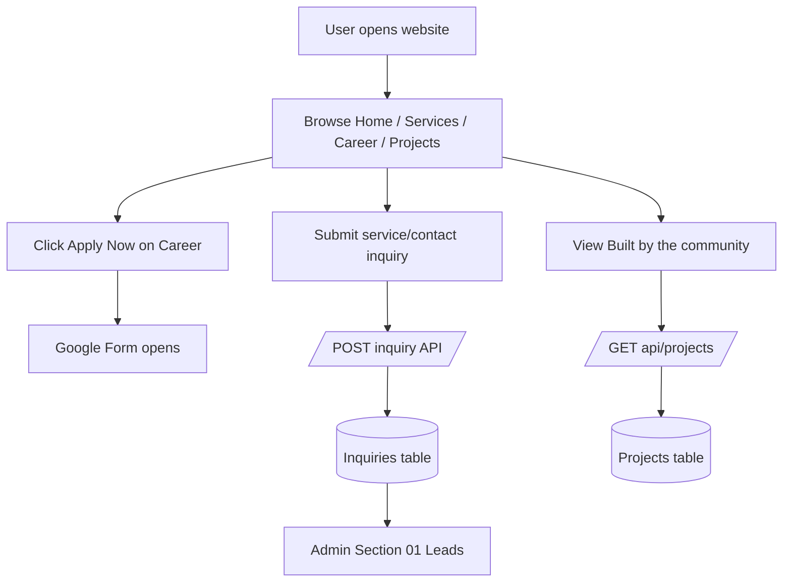

Important: Google Form responses do not automatically enter the database yet. Admin can manually add applicants in Section 03, or a future Google Sheets/API integration can sync them.

## 4. Admin Dashboard Sections

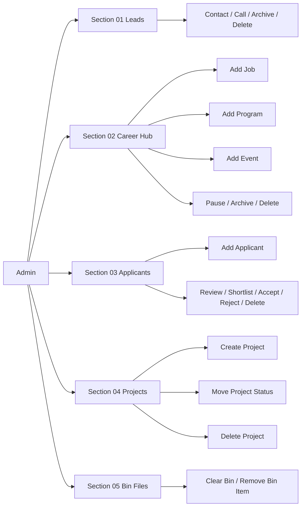

## 5. Leads Workflow

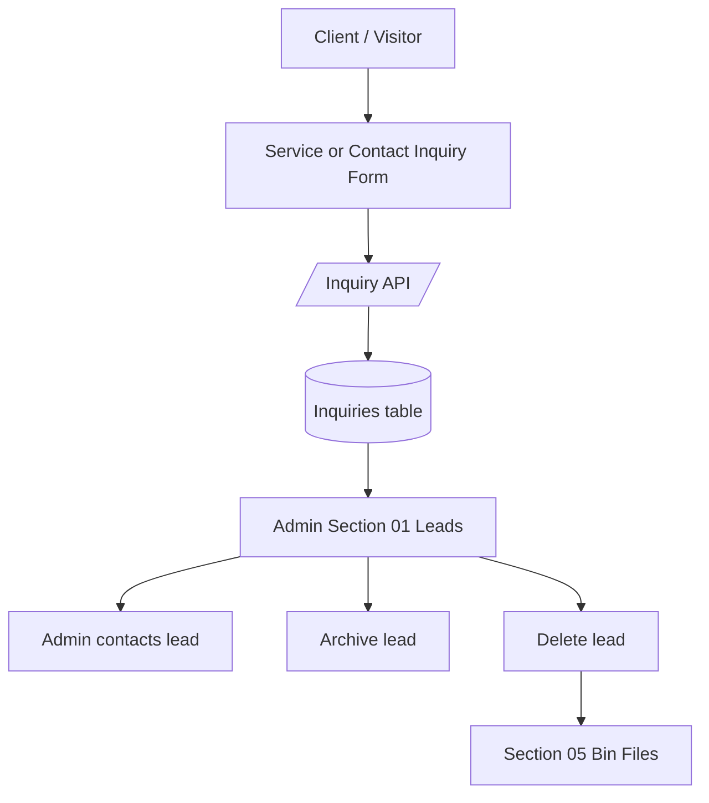

## 6. Career Hub Workflow

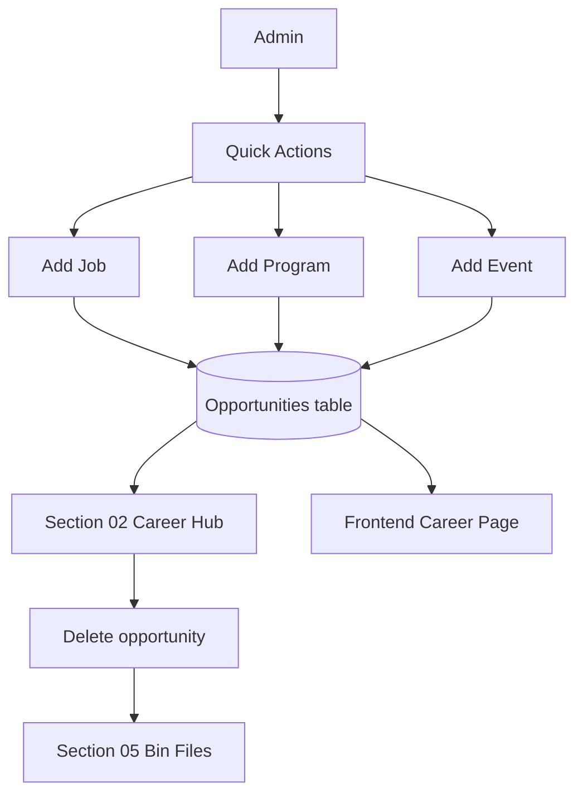

## 7. Event Posting Workflow

When admin adds an event, the app creates two records:

1. Opportunity record for Career Hub and Career frontend.
2. Project record for Projects frontend section.

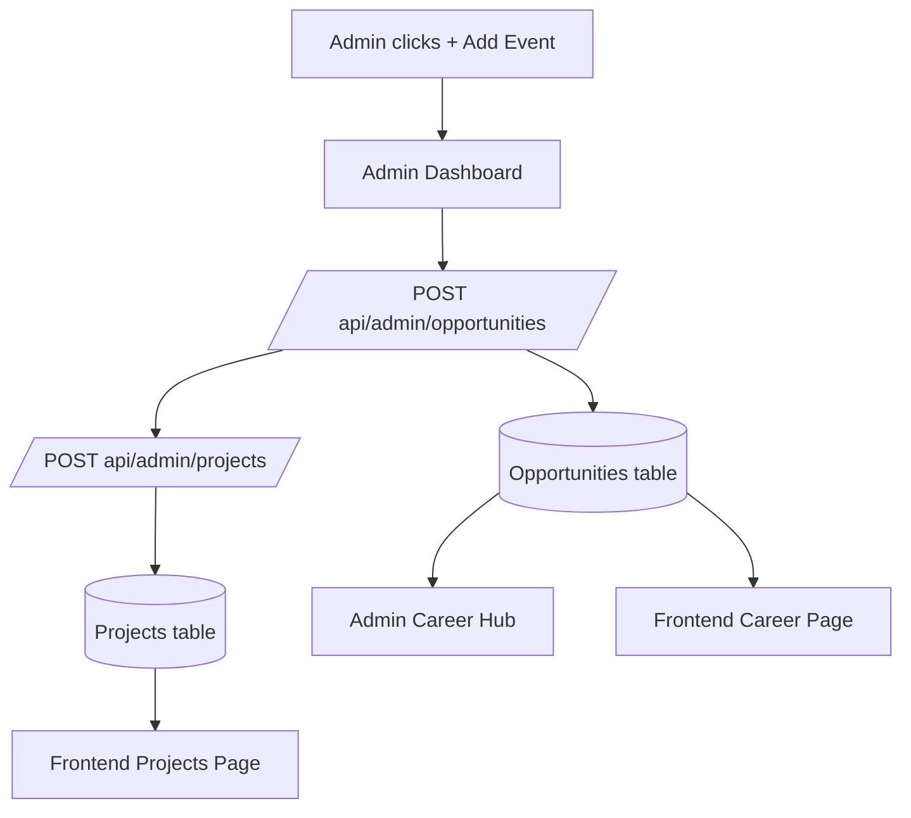

Frontend visibility:

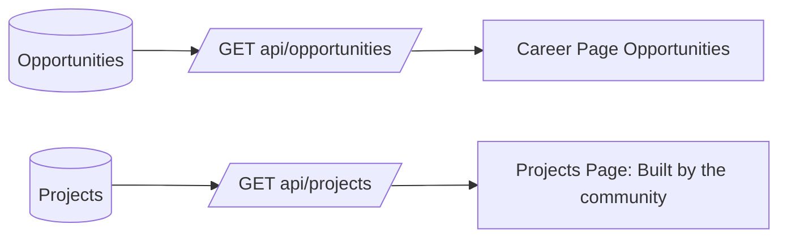

## 8. Applicants Workflow

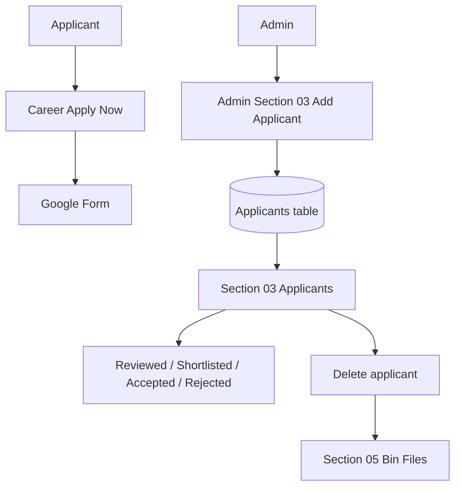

## 9. Projects Workflow

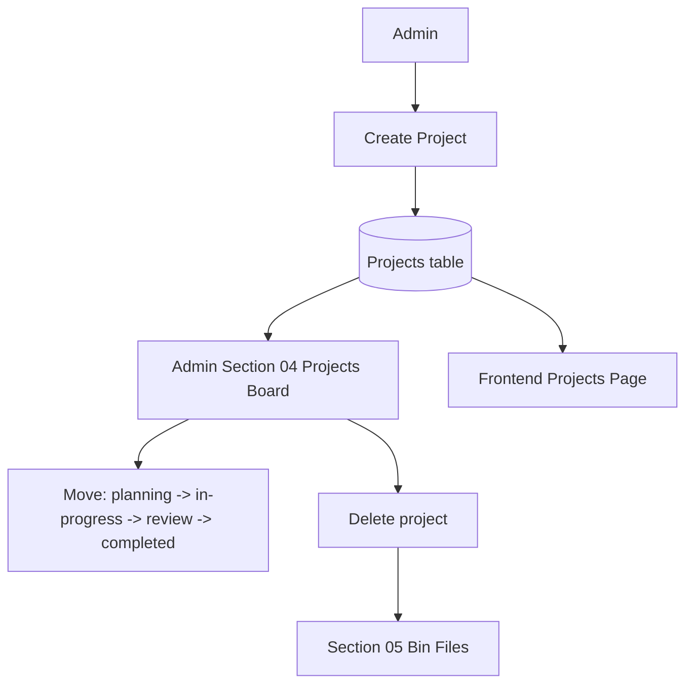

## 10. Delete And Bin Workflow

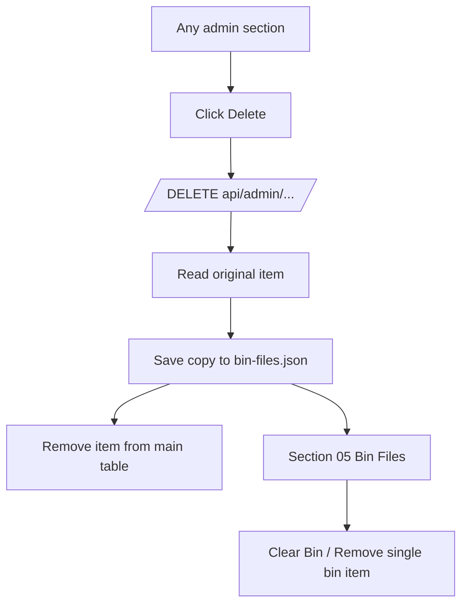

## 11. Quick Actions Mapping

| Admin Button | Backend Table | Frontend Impact |
| --- | --- | --- |
| Add Job | Opportunities | Shows on Career page |
| Add Program | Opportunities | Shows on Career page |
| Add Event | Opportunities + Projects | Shows on Career page and Projects page |
| Create Project | Projects | Shows on Projects page |

## 12. Main Data Map

| Data | Created From | Stored In | Shown In Admin | Shown In Frontend |
| --- | --- | --- | --- | --- |
| Lead / Inquiry | Service/contact form | Inquiries table | Section 01 Leads | No public listing |
| Job | Admin Add Job | Opportunities table | Section 02 Career Hub | Career page |
| Program | Admin Add Program | Opportunities table | Section 02 Career Hub | Career page |
| Event | Admin Add Event | Opportunities + Projects tables | Career Hub + Projects | Career page + Projects page |
| Applicant | Admin manual add / future sync | Applicants table | Section 03 Applicants | No public listing |
| Project | Admin Create Project | Projects table | Section 04 Projects | Projects page |
| Deleted Item | Admin delete action | bin-files.json | Section 05 Bin Files | No public listing |

## 13. Current Limitation

Google Form applications currently open externally. They do not automatically sync into Section 03 Applicants unless a Google Sheets/API integration is added later.

